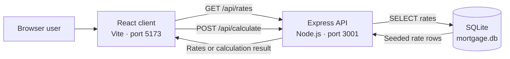

# Mortgage Calculator

A three-tier mortgage calculator for comparing seeded mortgage rates and estimating principal-and-interest payments. The application uses a React client, an Express API, and a local SQLite database.

## Features

- Browse fixed-rate, adjustable-rate, and FHA mortgage products.
- Select a listed rate to populate the calculator.
- Calculate monthly payment, total payment, and total interest.
- Navigate directly to combined, rates-only, or calculator-only views.

> The rates and calculations are for demonstration purposes only and are not financial advice.

## Architecture



The client fetches rate data when the calculator loads. Rate queries pass through the API to SQLite, while payment calculations are performed by the API and do not write to the database. On first startup, the server creates the `rates` table and seeds it if it is empty.

## Project structure

```text
.
├── client/                 React, React Router, Vite, and Tailwind CSS
│   └── src/
│       ├── components/     Navigation and mortgage calculator UI
│       ├── App.jsx         Routes and page layout
│       └── main.jsx        Browser entry point
├── server/
│   ├── database.js         SQLite initialization and rate seeding
│   ├── index.js            Express API and payment calculation
│   └── mortgage.db         Local SQLite database
├── docs/
│   └── TESTING.md          Validation and manual test procedures
└── .vscode/tasks.json      Combined development task
```

## Prerequisites

- Node.js 18 or newer
- npm

## Getting started

Install each application's dependencies from the repository root:

```bash
cd server && npm install
cd ../client && npm install
```

Start the API in one terminal:

```bash
cd server
npm run dev
```

Start the client in another terminal:

```bash
cd client
npm run dev
```

Open `http://localhost:5173`. The client expects the API at `http://localhost:3001`, so both processes must be running. Alternatively, run the **Run App** task in VS Code to start both.

The available client routes are:

| Route | View |
| --- | --- |
| `/` | Rates and calculator |
| `/rates` | Rates only |
| `/calculators` | Calculator only |

## API

### Get mortgage rates

```http
GET /api/rates
```

Returns the rows from the SQLite `rates` table:

```json
{
  "message": "success",
  "data": [
    {
      "id": 1,
      "product_name": "30-Year Fixed",
      "interest_rate": 6.5,
      "apr": 6.62,
      "term_years": 30
    }
  ]
}
```

### Calculate a payment

```http
POST /api/calculate
Content-Type: application/json

{
  "loanAmount": 300000,
  "interestRate": 6.5,
  "loanTermYears": 30
}
```

A successful response contains decimal values formatted as strings:

```json
{
  "monthlyPayment": "1896.20",
  "totalPayment": "682633.47",
  "totalInterest": "382633.47"
}
```

All three request fields are required. Missing values or an invalid calculation return HTTP `400` with an `error` property.

## How calculations work

The API uses the standard amortizing loan formula:

```text
M = P × [i(1 + i)^n] / [(1 + i)^n - 1]
```

Where `P` is the principal, `i` is the monthly interest rate, and `n` is the number of monthly payments. The estimate includes principal and interest only; it does not include taxes, insurance, fees, or other costs.

## Available commands

| Directory | Command | Purpose |
| --- | --- | --- |
| `client` | `npm run dev` | Start the Vite development server |
| `client` | `npm run build` | Create a production client build |
| `client` | `npm run lint` | Run ESLint |
| `client` | `npm run preview` | Preview the production build |
| `server` | `npm start` | Start the API with Node.js |
| `server` | `npm run dev` | Start the API with automatic restart |

Automated tests have not yet been configured. See [Testing](docs/TESTING.md) for the current validation workflow and manual test cases.

## Troubleshooting

- **Rates remain on “Loading rates...”**: confirm the server is running on port `3001` and inspect the browser console for request errors.
- **A port is already in use**: stop the process using port `3001` or `5173`; these ports are currently fixed in the application.
- **Database startup errors**: start the server from the `server` directory so the relative `./mortgage.db` path resolves correctly.
